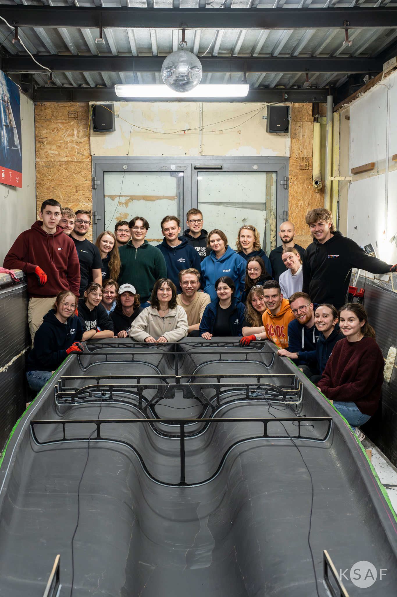

# Composite Bulkhead Analysis — AGH Solar Boat Team

## Overview
Structural design and numerical verification of the carbon-fibre sandwich bulkhead system for the **"Delta"** solar racing boat, carried out as a member of the **AGH Solar Boat Team** (Construction Section).

**My role:** geometry and placement of the hull bulkheads and their laminate definition in **Ansys ACP** (layer count and positioning), set-up of the load cases in Ansys Mechanical, and iterative structural verification of the design. The sandwich materials were selected within the team, and the hydrodynamic loads were based on the team's **Ansys Fluent CFD** results.

## Engineering Details
* **Organization**: AGH Solar Boat Team (Section: Construction).
* **Software**: Ansys ACP (Composite PrepPost), Ansys Mechanical, SolidWorks.
* **Materials**: CFRP sandwich — biaxial carbon fibre T800 (150 gsm) skins + Cascell 50 RS PVC foam core (10 mm).
* **ACP Workflow**: ply-by-ply modelling with **Rosettes**, **Oriented Selection Sets (OSS)** and **Modeling Groups** for fibre-orientation control ($0^\circ, 90^\circ, \pm45^\circ$).
* **Load Cases**: sudden sharp turn (pylon loads from CFD, two variants) and slamming (40 kPa on 0.58 m² of the hull).
* **Boundary Conditions**: **Inertia Relief** for the unconstrained boat, avoiding artificial stiffness from rigid supports.
* **Failure Assessment**: maximum stress criterion for the skins (Inverse Reserve Factor, IRF) and shear check of the foam core.

## Iterative Design Process
* **Iteration 1** – uniform layup: stress concentrations with **IRF > 2.1** in the central bulkhead region.
* **Iteration 2** – modified bulkhead geometry (three new bulkheads) and adjusted stacking sequence: overall stiffness improved, but new concentrations appeared near the hoisting points.
* **Iteration 3** – adjusted bulkhead positions and an added small cantilever bulkhead in front of the helmsman.
* **Final decision** – the remaining local exceedances (IRF slightly above 1.0) were, by a joint team decision, flagged for **local manual reinforcement** (carbon patches) during production instead of adding another global ply, to keep the boat light.
* **Design-to-Manufacture** – the final model provided the **layup schedule** for hand lay-up and vacuum infusion, prepared together with the production team.

*Figure 1: Composite bulkheads installed in the "Delta" hull.*

## Project Structure
* `Composite_Bulkhead_Analysis.md` – detailed technical report: ACP workflow, load cases and the three design iterations.
* `Modelowanie i symulacja kompozytów w Ansys ACP.pdf` – presentation: composite modelling workflow in Ansys ACP (Polish).
* `analiza strukturalna grodzi kompozytowych w łdozi solarnej Delta.pdf` – presentation: structural analysis of the Delta bulkhead system (Polish).
