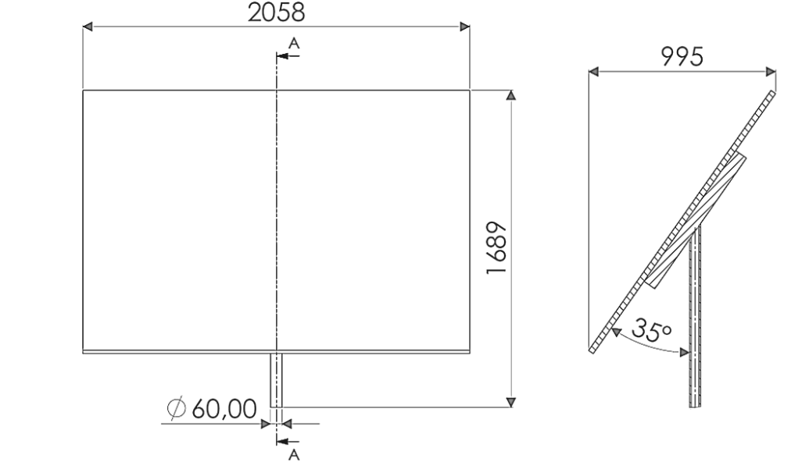
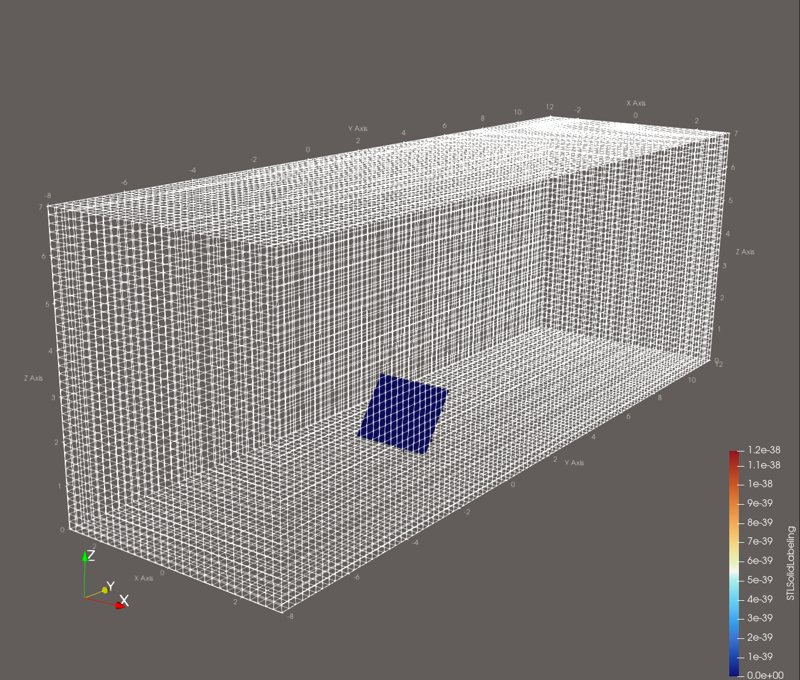
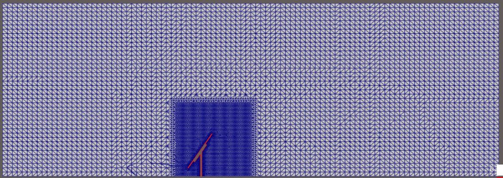
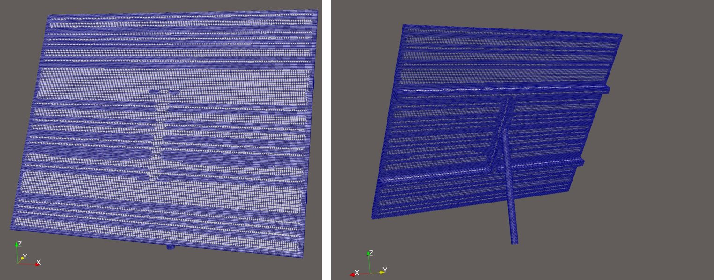
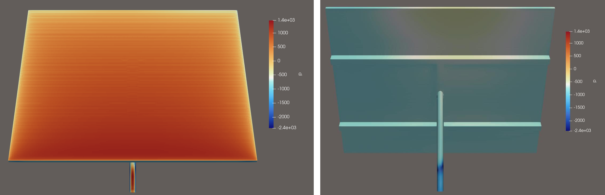
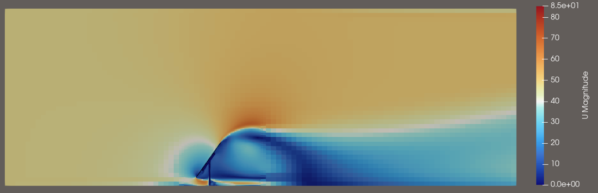
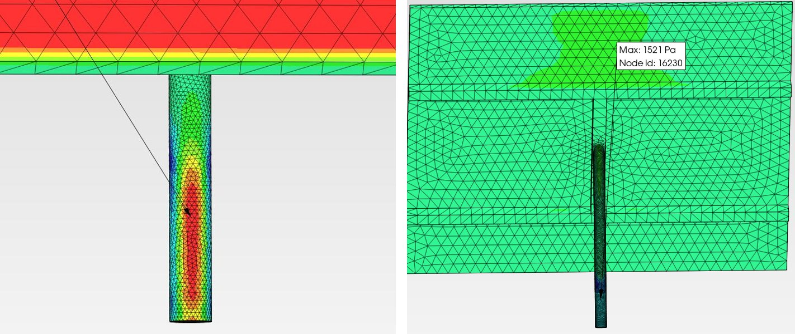
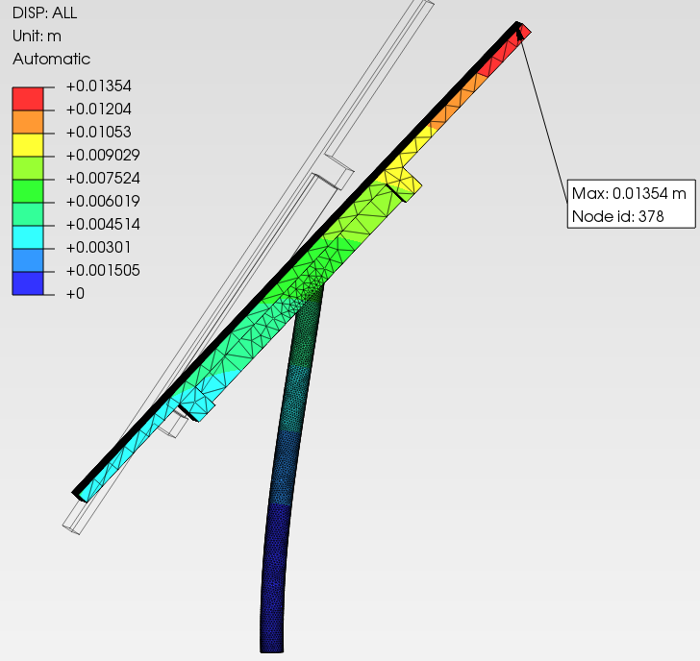
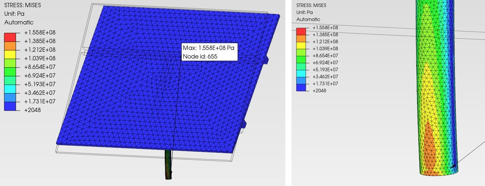

# One-Way FSI of a PV Structure Using Open-Source Tools (OpenFOAM → CalculiX)

## Overview
Re-implementation of the wind-load FSI workflow from my [Ansys-based FSI project](../FSI_Solar/) using **only open-source software**. The same ground-mounted photovoltaic structure is loaded by a $47\ \text{m/s}$ gust (peak wind speed recorded in Poland): the surface pressure field from an **OpenFOAM** CFD run is mapped onto a **CalculiX** structural model in **PrePoMax**.

The aim of the project was to master an open-source CAE toolchain end to end — every case is set up directly from text dictionaries, without a GUI wizard — rather than to produce a fully optimised CFD result. Its limitations are listed openly in the [Retrospective review](#retrospective-review) section.

*Course project: "Open Source CAE Tools", AGH University of Krakow (supervisor: Ireneusz Czajka, DSc, Eng.), June 2025.*

## Toolchain

| Step | Tool | Platform |
| :--- | :--- | :--- |
| Geometry | FreeCAD 1.0.1 | Windows 11 |
| CFD (meshing, solver) | OpenFOAM v2412 (`blockMesh`, `surfaceFeatureExtract`, `snappyHexMesh`, `simpleFoam`) | Ubuntu 22.04 LTS (WSL) |
| CFD post-processing | ParaView 6.0 | Windows 11 |
| Structural FEA | CalculiX 2.22 in PrePoMax 2.3.5 | Windows 11 |
| Case editing | Notepad++ | Windows 11 |



*Figure 1: Structure geometry – two panels (2058 × 1689 mm) on a single Ø60 mm post, 35° tilt.*

## CFD Setup (OpenFOAM)

### Geometry and domain
* CAD exported to STL, placed in `constant/triSurface` and scaled from mm to m with `surfaceConvert -clean -scale 0.001`.
* **`blockMesh`** background domain: 6 × 20 × 7 m box, 30 × 100 × 40 hexahedral cells (0.2 m base size), boundary patches: `inlet`, `outlet`, ground/top and side walls.



*Figure 2: Background hexahedral domain with the structure inside.*

### Mesh generation
* **`surfaceFeatureExtract`** – feature edges extracted from the STL (included angle 150°).
* **`snappyHexMesh`** – castellation and snapping onto the structure:
  * surface refinement level (3 5) on the structure, feature-edge refinement level 2,
  * additional refinement box around the structure and its near wake,
  * boundary-layer prism layers disabled (`addLayers false`).



*Figure 3: Mid-plane section – refinement box around the structure.*



*Figure 4: Snapped surface mesh on the panels, rails and post.*

### Physics and boundary conditions
* Steady, incompressible RANS – **`simpleFoam`** with the **k–ω SST** turbulence model.
* Inlet: fixed velocity $47\ \text{m/s}$; outlet: fixed pressure ($p = 0$), `inletOutlet` for velocity.
* Initial turbulence fields: $k = 4.15\ \text{m}^2/\text{s}^2$, $\omega = 15.5\ \text{s}^{-1}$.
* 1000 iterations; surface pressure on the structure sampled every 100 iterations with a `surfaceFieldValue` function object and written to VTK for the structural step.

### Parallel run
```bash
decomposePar                      # scotch decomposition into 8 subdomains
mpirun -np 8 simpleFoam -parallel
reconstructPar
```

### CFD results



*Figure 5: Pressure on the windward (left) and leeward (right) side of the structure.*



*Figure 6: Velocity magnitude in the mid-plane – acceleration over the upper edge and separated wake behind the panels.*

## Structural Setup (CalculiX / PrePoMax)
* Tetrahedral mesh of the structure, refined around the post.
* Material: structural steel – $E = 200\ \text{GPa}$, $\nu = 0.3$, $\rho = 7800\ \text{kg/m}^3$.
* Loads and supports: **imported pressure** from the OpenFOAM VTK output (closest-node interpolation), gravity, fixed support at the base of the post.



*Figure 7: OpenFOAM pressure field mapped onto the CalculiX model in PrePoMax.*

## Results

| Quantity | Value |
| :--- | :--- |
| Max total displacement (top edge of panels) | $13.5\ \text{mm}$ |
| Max displacement in wind direction | $13.0\ \text{mm}$ |
| Max von Mises stress (base of the post) | $156\ \text{MPa}$ |



*Figure 8: Total displacement (deformed shape).*



*Figure 9: Von Mises stress – whole structure (left) and stress concentration at the base of the post (right).*

## Known Limitations & Next Steps
The project focused on mastering the open-source toolchain, so several simplifications were accepted. If I were to repeat the case, I would:

* **Convert pressure units before mapping** – incompressible solvers such as `simpleFoam` output kinematic pressure ($p/\rho$, m²/s²), so the field should be multiplied by $\rho$ (or computed in Pa with the `pressure` function object) before import into the structural model.
* **Enlarge the domain** and use slip/symmetry side and top boundaries to remove confinement effects.
* **Add prism layers** (`addLayers true`) and check $y^+$ near the walls.
* **Run a mesh-independence study**, as done in the Ansys version of the case.

## Takeaways
* Open-source CAE is a capable alternative to commercial tools, with a higher entry threshold.
* Working directly with input dictionaries gives full control over – and understanding of – every modelling decision.
* Data transfer between solvers needs explicit checks of **units, reference pressure and mapping quality**.

## Files
* `FSI_OpenSource_Presentation_EN.pdf` – full project presentation (English), including all OpenFOAM dictionaries.
* `images/` – figures used in this README.
